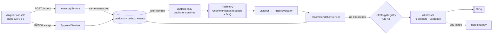

# StockPulse: AI Inventory & Dynamic Pricing

Built for a **clothing supplier in India (prices in ₹)**. When stock drops below its reorder threshold or demand spikes, StockPulse automatically asks an AI advisor (or, if it fails, a rule engine) for a **new price** and a **restock quantity**. It then shows them as **one recommendation per product** for the merchandiser to accept or reject. Prices and stock never change without a human accept.

New to the project? Start with the [plain-language application guide](docs/application-guide.md) for the idea, technology, diagrams, backend map, and database entities.

```
Sell 1  →  stock + outbox row (one transaction)  →  RabbitMQ  →  triggers  →  AI / rules  →  PENDING suggestions  →  Accept  →  price / stock updated
```

| | |
|---|---|
| Backend | Java 21 · Spring Boot 3.5 · JPA · Flyway · PostgreSQL 16 / H2 · RabbitMQ (transactional outbox) |
| Frontend | Angular 19 · signals + RxJS · Angular Material 19 · white & blue design tokens · ₹ (`en-IN`) |
| AI | Groq free tier (`openai/gpt-oss-20b`) via `LLMGateway`; Ollama and Gemini supported |
| Decisions | [ADR.md](ADR.md) · How it works: [docs/flows/](docs/flows/README.md) · Contract: [contracts/openapi.yaml](contracts/openapi.yaml) |

---

## Run it

Two options: a 2-minute local run with no Docker for the backend, or the full stack. Both start with the same setup step.

### 0. One-time setup
```bash
cp .env.example .env
# Set POSTGRES_PASSWORD and RABBITMQ_PASSWORD to any local values.
# Optional, for real AI: LLM_API_KEY=<free key from https://console.groq.com/keys>
```
Without a key, everything still works: AI suggestions fall back to the rule engine and are labelled **Fallback · NOT_CONFIGURED**.

### A. Quick run: backend on H2 (needs only Java 21)
```bash
cd backend && ./mvnw spring-boot:run          # http://localhost:8080 (in-memory DB, seeded, in-process loop)
```
Frontend (pick one):
```bash
# Docker (recommended: Angular 19 needs Node 18/20/22; this runs Node 22 in a container)
FRONTEND_PROXY=proxy.host.conf.json docker compose --profile frontend up --no-deps frontend

# or with Node 22 on the host
cd frontend && npm ci && npx ng serve          # proxies /api to localhost:8080
```
Open **http://localhost:4200**.

### B. Full stack: PostgreSQL + RabbitMQ + backend + frontend (Docker)
```bash
docker compose --profile frontend up -d --build
```
| URL | What |
|---|---|
| http://localhost:4200 | Merchandising console |
| http://localhost:8080/swagger-ui.html | API docs (renders the hand-written contract) |
| http://localhost:15672 | RabbitMQ UI (user/password from `.env`) |
| http://localhost:8080/actuator/health | Health (DB + broker) |

Stop with `docker compose down` (data is kept in volumes; add `-v` to reset).

### Turn on AI
Set `LLM_API_KEY` in `.env`, restart the backend, then set **Pricing: ai** and **Reorder: ai** in the console's top bar. The switch takes effect immediately and is persisted; no restart needed.

---

## Demo walkthrough (about 2 minutes)

1. **Catalog** → *Organic Cotton T-Shirt – Black* (PRD-003): ₹799, stock **8**, threshold **15**, margin 55%.
2. Click **Sell 1**. The order returns in about 50 ms. About 2 s later, **Recommendations** shows **one card** for the T-Shirt: a **new price** (e.g. ₹799 → ₹879, margin 55% → 59%) and a **restock quantity**, with a **Low stock** badge, an **AI** chip, confidence and reasoning for each.
3. Click **Sell 1** again: still one card (the same trigger is de-duplicated).
4. Click **↻ Recalculate**: fresh numbers replace the card (the old one becomes `SUPERSEDED`).
5. **Accept all** → the catalog shows the new price and stock (click **History** for the price chart). Or accept/reject price and restock separately.
6. **Demand spike:** sell *Pullover Hoodie* (PRD-008) **3 times**. Its velocity passes 3× the other clothing items' average and a **Demand spike** recommendation appears with different reasoning (spike size, stock headroom, goodwill).
7. **Resilience:** remove the key (or point `LLM_BASE_URL` somewhere broken) and sell again. The card says **Fallback · <reason>**. Nothing is lost.

The same flow with curl:
```bash
curl -X POST localhost:8080/api/v1/products/PRD-003/orders -H 'Content-Type: application/json' -d '{"quantity":1}'
curl 'localhost:8080/api/v1/pricing-suggestions?status=PENDING'
curl -X PATCH localhost:8080/api/v1/pricing-suggestions/1 -H 'Content-Type: application/json' -d '{"status":"ACCEPTED"}'
```

---

## How it works



- **Prices change only by accepting a suggestion.** Product status is derived (`OUT_OF_STOCK` → `PRICE_REVIEW_PENDING` → `ACTIVE`), never set by clients.
- **The LLM is never called inside a database transaction.** Generation runs in three phases: short read, strategies with no transaction, short write.
- **No silent drops.** AI failures (timeout, 429, invalid JSON, absurd price, budget, open circuit) become rule suggestions with a recorded `fallbackReason`. Infrastructure failures retry 3 times, then go to the dead-letter queue.
- **One recommendation per product.** At most one PENDING price and one PENDING restock per product. The same trigger is de-duplicated, while a new trigger or **Recalculate** replaces it (the old one becomes `SUPERSEDED`). Redelivered messages are skipped (`processed_messages`).
- **Two triggers, two prompts.** *Low stock* asks the model to weigh raising the price vs clearance vs hold. *Demand spike* sizes the increase to the spike and stock headroom.
- **Pluggable strategies.** A new strategy is one class implementing `PricingStrategy` / `ReorderStrategy`, and it shows up in the top-bar switch.

Details: [docs/flows/](docs/flows/README.md) (backend, agentic loop, LLM, frontend, observability, QA) and [ADR.md](ADR.md).

## API

Base path `/api/v1`. Full contract: [contracts/openapi.yaml](contracts/openapi.yaml), browsable at `/swagger-ui.html`.

| | |
|---|---|
| `POST /products` · `GET /products?status=&category=` · `GET /products/{id}` | Catalog |
| `PATCH /products/{id}/stock` · `POST /products/{id}/orders` | Stock change / simulated sale (fires the loop) |
| `POST /products/{id}/suggest-pricing` · `/suggest-reorder` | Recalculate now (`MANUAL`); replaces the pending one |
| `GET /pricing-suggestions?status=` · `GET /reorder-suggestions?status=` | Review queue |
| `PATCH /pricing-suggestions/{id}` · `/reorder-suggestions/{id}` | `{"status":"ACCEPTED"|"REJECTED"}` |
| `GET/PUT /admin/strategies` | Runtime switch: `{"pricing":"ai","reorder":"rule"}` |

Every error uses one shape: `{timestamp, status, error, code, message, path, traceId, errors[]}`. The UI shows the first 8 characters of `traceId` as **Error ref**. Search for it in `backend/logs/`.

## Tests

```bash
cd backend && ./mvnw verify                      # 66 tests + Spotless + JaCoCo (H2, no Docker needed)
docker compose run --rm --entrypoint npm ng run test:ci   # 26 Karma tests (Chrome headless, Node 22)
docker compose run --rm ng lint
npx --yes @stoplight/spectral-cli@6 lint contracts/openapi.yaml
```
The backend tests cover the whole loop through the HTTP API, 12 concurrent orders producing exactly one suggestion pair, every AI failure mode against an in-JVM fake LLM, prompt differences and injection safety, the error shape, and the controller/entity/integration layer boundaries (ArchUnit).

## Configuration

| Variable | Default | Purpose |
|---|---|---|
| `LLM_PROVIDER` | `groq` | `groq`, `ollama`, `gemini` |
| `LLM_MODEL` | `openai/gpt-oss-20b` | Groq model (`openai/gpt-oss-120b` is stronger but slower) |
| `LLM_API_KEY` | empty | Free Groq key; empty means rule fallback |
| `STOCKPULSE_MESSAGING_MODE` | `in-process` (H2) / `rabbitmq` (Docker) | Loop transport |
| `POSTGRES_PORT` | `5432` | Host port; change it if 5432 is already used |
| `stockpulse.trigger.spike-multiplier` | `3.0` | Spike = velocity > 3× peer average |
| `stockpulse.pricing.min-ratio` / `max-ratio` | `0.5` / `2.0` | Allowed AI price range |
| `llm.max-calls-per-minute` | `30` | Free-tier budget |

## Troubleshooting
- **`port 5432 already in use`**: set `POSTGRES_PORT=55432` in `.env`.
- **Angular CLI complains about Node 24/26**: use the Docker commands above (Node 22 inside).
- **Cards say `Fallback · PROVIDER_ERROR`**: the model name may have been retired. List the available ones with `curl https://api.groq.com/openai/v1/models -H "Authorization: Bearer $LLM_API_KEY"`.
- **Fresh demo data** (Docker): `docker compose --profile frontend down -v && docker compose --profile frontend up -d --build` (**deletes** the Docker database volume; migrations re-seed the clothing catalog).
- **Logs**: `backend/logs/` (`stockpulse-backend.log`, `-failures.log`, `-access.log`, `-audit.log`; JSON Lines).

## Repository
```
backend/      Spring Boot app (catalog, inventory, recommendation[+ai], approval, messaging, integration.llm, shared)
frontend/     Angular 19 console (core, shared, features/console, features/products)
contracts/    openapi.yaml: the frozen API contract
docs/         delivery plan, flow guides, UI theme
ADR.md        architecture decisions
```

## Deliberately not built (see [ADR-6](ADR.md#adr-6-extensibility-seams-and-deliberate-exclusions))
Authentication, competitor pricing, supplier catalog, auto-apply, purchase orders, a rolling 24 h velocity window, and the SSE reasoning stream. The seams for Sprint 2 (`costPrice` / `marginFloor` / `supplierId` columns, the `PriceGuardrail` chain, strategy registration) are in place.
