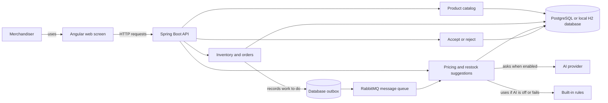

# StockPulse: The Simple Application Guide

This is the friendly starting point for understanding the whole application. It explains what the app does, what it is made with, how a sale turns into a suggestion, and where the main backend code lives.

## The Idea

StockPulse helps a clothing shop notice when an item is selling quickly or running low. It suggests a price and how many items to restock. A person reviews each suggestion. **The app never changes a price or adds stock until that person accepts the suggestion.**

Think of it as a helpful assistant: it notices, recommends, and waits for approval.

## The Whole App At A Glance



The main story, step by step:

1. A merchandiser records a sale, or changes the stock count.
2. The backend saves the stock change and a note that recommendation work is needed.
3. A background worker checks whether stock is low or demand is unusually high.
4. It asks the chosen strategy for advice: AI when enabled, or built-in rules. If AI fails, the rules provide a backup suggestion.
5. The web screen shows the suggestion for a person to review.
6. Only after acceptance does the backend apply the suggested price or add the suggested restock quantity. A recorded sale still reduces stock immediately.

In the quick local run, the same background work is delivered inside the application instead of through RabbitMQ. The sale and recommendation behavior is otherwise the same.

## Technology

| Part | Technology | In simple terms |
|---|---|---|
| Backend | Java 21, Spring Boot 3.5 | Receives requests and applies the business rules |
| Web screen | Angular 19 | The pages the merchandiser uses |
| Main database | PostgreSQL 16 | Stores products, stock, and suggestions when running the full stack |
| Local database | H2 | A small in-memory database for a quick local backend run |
| Database changes | Flyway | Applies versioned instructions for creating and updating database tables |
| Background messages | RabbitMQ | Delivers recommendation work without making the sale request wait |
| AI | Groq by default; Gemini and Ollama are supported | Optional outside service that can draft advice |
| API description | `contracts/openapi.yaml` | The agreed list of HTTP requests and responses |

The app also has a rule-based advisor. The system can still make suggestions when no AI key is configured or the AI service is unavailable.

## How The Backend Is Organized

Backend code is grouped by **job first**. Every controller is in `controller/`, every service and repository is in `service/`, and every entity or domain data type is in `entity/`. The filename says what the code does, such as `ProductController`, `InventoryService`, or `PricingSuggestion`.

```text
backend/src/main/java/com/stockpulse/
  controller/       all HTTP controllers and API request/response types
  service/          all business services, repositories, and service helpers
  entity/           all database entities and domain data types
  recommendation/   AI prompts, guardrails, and strategy implementations
  messaging/        background message delivery
  integration/llm/  connection to AI providers
  shared/           shared errors, logging, and web utilities
```

For example, `ProductController.java`, `ProductService.java`, and `Product.java` sit in the three layer folders. Their names make the product feature clear, while the folder tells you each file's job. Architecture tests make sure controllers do not reach into messaging or AI-provider infrastructure and entities do not depend on services or controllers. The package layout no longer enforces boundaries between business features.

| If you want to understand... | Start here |
|---|---|
| Product endpoints | `controller/ProductController.java` |
| Product rules and database record | `service/ProductService.java` and `entity/Product.java` |
| Recording a sale or stock change | `controller/InventoryController.java` and `service/InventoryService.java` |
| Making suggestions | `service/RecommendationService.java` |
| Accepting or rejecting advice | `controller/DecisionController.java` and `service/ApprovalService.java` |
| AI and its rule-based backup | `recommendation/ai/` and `recommendation/strategy/rule/` |

The paths in this table are relative to `backend/src/main/java/com/stockpulse/`.

## Database Records, In Plain Language

An **entity** is a Java object the backend saves as a database row. The main records are:

| Database table | Entity | What it remembers |
|---|---|---|
| `products` | `Product` | Product name, category, price, stock, reorder threshold, and demand count |
| `pricing_suggestions` | `PricingSuggestion` | A proposed price, its reason, where it came from, and whether it is waiting, accepted, or rejected |
| `reorder_suggestions` | `ReorderSuggestion` | A proposed restock quantity, its reason, and its decision status |
| `inventory_events` | `InventoryEvent` | A history entry for a sale or stock change |
| `outbox_events` | `OutboxEvent` | Background work saved alongside a stock change so it is not lost if the app stops |
| `processed_messages` | `ProcessedMessage` | A record that helps prevent the same background message being handled twice |
| `app_settings` | `AppSetting` | Runtime choices, such as whether pricing advice uses AI or rules |

The two suggestion types are separate because changing a price and ordering more stock are different decisions. Each can be accepted or rejected separately.

## Important Rules

- A price changes only when a person accepts a pricing suggestion.
- Stock from an accepted restock suggestion is added only when a person accepts it.
- A product's status is worked out from its stock and pending suggestions; clients do not choose it.
- AI work happens outside database transactions. A slow AI call cannot hold a database write open.
- If AI advice cannot be used, a rule-based suggestion is recorded instead of silently losing the request.
- Repeated delivery of the same background message should not create repeated work.

## API And Running The App

The API starts with `/api/v1`. Common requests include:

| Action | Request |
|---|---|
| List products | `GET /api/v1/products` |
| Record a sale | `POST /api/v1/products/{id}/orders` |
| Change stock | `PATCH /api/v1/products/{id}/stock` |
| View price suggestions | `GET /api/v1/pricing-suggestions` |
| View restock suggestions | `GET /api/v1/reorder-suggestions` |
| Accept or reject a suggestion | `PATCH /api/v1/pricing-suggestions/{id}` or `PATCH /api/v1/reorder-suggestions/{id}` |

For a quick backend run, use Java 21:

```bash
cd backend
./mvnw spring-boot:run
```

This uses the local H2 database and does not require PostgreSQL or RabbitMQ. The [README](../README.md) has full-stack setup steps and demo instructions.

## Where To Read Next

- [Backend request flows](flows/backend/README.md): what controllers and services do for each request.
- [Background recommendation loop](flows/agentic-loop/README.md): outbox, RabbitMQ, retries, and duplicate protection.
- [AI details](flows/llm/README.md): prompts, supported providers, validation, and fallback behavior.
- [Frontend flows](flows/frontend/README.md): pages, polling, and accept/reject actions.
- [API contract](../contracts/openapi.yaml): complete request and response definitions.
- [Architecture and delivery plan](architecture/stockpulse-delivery-plan.md): detailed system design and requirements.
- [Architecture decisions](../ADR.md): why important design choices were made.
- [Development readiness](architecture/development-readiness.md): what is implemented and what remains.