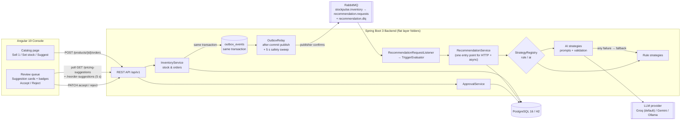

# StockPulse: How It Works (Flow Guide)

This folder explains **how StockPulse works end to end**: what happens, in which order, in which component, and why.

Use these documents for:
- Developer onboarding
- Understanding component responsibilities
- Demo preparation
- Project walkthroughs
- Tracing the complete core flow: **Order → Stock drop → Async suggestions → Accept price**

---

## Status Legend

Every flow document uses this legend:

| Status | Meaning |
|---|---|
| 🟦 Designed | Agreed in the delivery plan, not implemented yet |
| 🟨 In progress | Implementation has started; file paths may still be planned names |
| 🟩 Implemented | Code exists, real file paths are documented, and the implementer's tests pass |
| ✅ Verified | QA tests pass, with links to the tests in the Verification section |

> **Current overall status: 🟦 Designed: planning complete, implementation not started.**
>
> - Done: SE-01 (ADR-1..ADR-10), SE-03 (docker-compose, `.env.example`), delivery plan, UI theme, team agents, flow skeletons (SE-00).
> - Next: SE-02 (`contracts/openapi.yaml`, then freeze) → BE-01 and FE-01 in parallel.
> - Execution order: **demo floor first**. Build H2 + rule strategy end to end (BE-01..BE-08 + FE-01..FE-05), then AI (BE-09, BE-12), then RabbitMQ (BE-10), then bonus (BE-11, FE-07/08).
> - No backend or frontend code exists yet; no tests have been run.
>
> See the [Development Readiness Tracker](../architecture/development-readiness.md) for per-task status.

---

## Folder Structure

| Folder | What it explains | Maintained by |
|---|---|---|
| [backend/](backend/README.md) | API requests, modules, database, transactions, errors, and how each endpoint flows through the code | `backend-engineer` |
| [agentic-loop/](agentic-loop/README.md) | **The heart of the system:** how a stock or order change automatically produces suggestions (outbox, RabbitMQ, triggers, de-duplication, retries, DLQ, recovery) | `backend-engineer` |
| [llm/](llm/README.md) | The AI advisor: prompt selection, LLM gateway, providers (free tier), parsing, validation, fallback reasons, cost and safety | `backend-engineer` |
| [frontend/](frontend/README.md) | The merchandising console: screens, component tree, stores, polling, accept/reject flows, error display | `angular-architect` |
| [observability/](observability/README.md) | **Standard error response**, **backend log files** (`backend/logs/`), event catalogue, frontend error handling, and how to trace any failure with one `traceId` | `backend-engineer` + `angular-architect` |
| [qa/](qa/README.md) | How each flow is verified: test map, failure injection, demo verification script, how to run the tests | `qa-engineer` |

---

## The Whole System in One Picture

> On the zero-setup `local` profile (H2), `stockpulse.messaging.mode=in-process`. The outbox row is still written, and an after-commit listener calls the same `RecommendationRequestListener` handler directly, with no broker. Everything else is identical.

---

## The Core Story in 6 Steps

This is the main flow shown in the demo and the walkthrough.

| # | What the user sees | What happens inside | Read more |
|---|---|---|---|
| 1 | Merchandiser clicks **Sell 1** on *Organic Cotton T-Shirt* (PRD-003, stock 8, threshold 15) | `POST /api/v1/products/PRD-003/orders {quantity:1}`. In **one transaction**: stock 8 → 7, velocity +1, `inventory_events` row, **`outbox_events` row** | [Backend: Simulate a sale](backend/README.md#flow-2-simulate-a-sale) |
| 2 | The response comes back immediately (target p95 **< 150 ms**) | The transaction commits. An after-commit signal tells `OutboxRelay` to publish the row to RabbitMQ (publisher confirms → row `PUBLISHED`). A 5 s sweep only catches rows left behind by a crash or broker outage. No broker or AI call blocks the request | [Agentic loop: Step 1](agentic-loop/README.md#step-1-signal-written-durably-transactional-outbox) |
| 3 | *(invisible)* | The consumer skips the message if `processed_messages` already has it, evaluates triggers (7 < 15 → `INVENTORY_LOW`), checks `pending_key` (no PENDING pair yet), then runs the pricing and reorder strategies **in parallel, outside any transaction** | [Agentic loop](agentic-loop/README.md) |
| 4 | *(invisible)* | The AI strategy renders the *inventory-low* prompt, calls the LLM, and parses and validates the JSON. On **any** failure it falls back to the rule strategy and records `fallbackReason` (e.g. `TIMEOUT`, `INVALID_JSON`, `OUT_OF_BOUNDS`) | [LLM advisor](llm/README.md) |
| 5 | Within about **5 s**, the review queue shows a **pricing card** and a **reorder card** with a *Low stock* badge, confidence, source (AI / Rule / Fallback) and reasoning | The console polls `GET /pricing-suggestions?status=PENDING` and `GET /reorder-suggestions?status=PENDING` every 5 s (paused when the tab is hidden) | [Frontend: Flow B](frontend/README.md#flow-b-new-suggestions-appear) |
| 6 | **Accept** on price → the price updates in the catalog. **Accept** on reorder → stock +N; status returns to ACTIVE | `PATCH /pricing-suggestions/{id} {status:ACCEPTED}` runs one transaction: check PENDING → set `currentPrice` → mark ACCEPTED → mark sibling PENDING pricing suggestions SUPERSEDED → re-derive product status | [Backend: Flow 4](backend/README.md#flow-4-accept-or-reject-a-suggestion) |

The **demand-spike** path (PRD-008) is the same story with `DEMAND_SPIKE`: it fires when velocity exceeds 3× the average velocity of the *other* products in the category (see [agentic-loop: Step 3](agentic-loop/README.md#step-3-evaluate-triggers)).

---

## Key Invariants (true in every flow)

| # | Invariant | Enforced by |
|---|---|---|
| I-1 | Price changes only by accepting a PricingSuggestion | `ApprovalService`; no price field on stock or order requests |
| I-2 | Product status is derived, never set by clients | `ProductStatusPolicy` after every write |
| I-3 | No LLM call inside a DB transaction | 3-phase `RecommendationService`; reviewed in every PR |
| I-4 | No silent drop: every trigger yields a suggestion or a recorded reason | `Fallback*Strategy`, outbox, retries → DLQ |
| I-5 | At most one PENDING suggestion per product + trigger + type | `pending_key` unique column + `processed_messages` |
| I-6 | One error shape, one `traceId` from UI to logs | `ApiErrorResponseFactory`, trace filter, "Error ref" in UI |

---

## Who Updates What?

Every agent **must** update its flow document at the end of each task. This is in each agent's instructions and in `CLAUDE.md` rule 6.

1. Update the flow status: 🟦 → 🟨 → 🟩. QA changes it to ✅ after verification.
2. Replace *planned* file names with real repository paths.
3. Record any behaviour that differs from the design, and why (and tell `principal-architect` if an ADR is affected).
4. Add a row to the document's **Implementation log**.
5. Update the task row in the [readiness tracker](../architecture/development-readiness.md).

> If a flow document is marked 🟩 or ✅ but the code behaves differently, the document is wrong. Raise it with the Senior Engineer (`principal-architect`).

### Flow document template
Every flow doc follows the same shape: **Status table → Flows (each with trigger, steps, files, failure modes) → Deviations from design → Verification → Implementation log.**

---

## Related Documents

- [Delivery plan](../architecture/stockpulse-delivery-plan.md): source of truth
- [Development readiness tracker](../architecture/development-readiness.md)
- [API contract](../../contracts/openapi.yaml): contract v1 (SE-02; frozen once SE-02 is approved)
- [Architecture decisions](../../ADR.md): ADR-1 to ADR-10
- [UI theme](../design/ui-theme.md): minimalist design tokens
- Team agents: [`.claude/agents/`](../../.claude/agents/)
