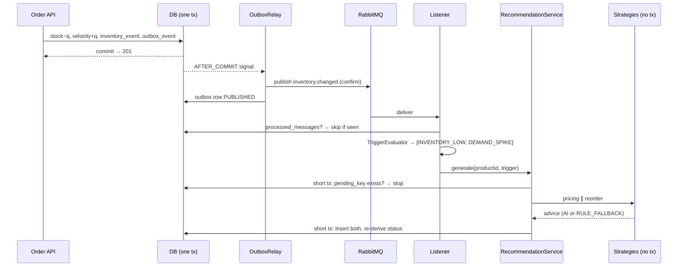

# Agentic Loop Flow

Maintained by `backend-engineer` · Design: plan §C.5, §C.6, §C.11 · ADR-5

**Observe** (stock/velocity signal) → **reason** (strategy) → **act** (queue PENDING suggestions) → **checkpoint** (merchandiser approves). The system proposes; humans publish prices and place orders.

## Status
| Step | Status | Task |
|---|---|---|
| Step 1: Signal written durably (transactional outbox) | 🟩 Implemented | BE-04 |
| Step 2: Publish and deliver | 🟩 Implemented (in-process + RabbitMQ) | BE-08 (in-process), BE-10 (RabbitMQ) |
| Step 3: Evaluate triggers | 🟩 Implemented | BE-08 |
| Step 4: Generate suggestions | 🟩 Implemented | BE-06 |
| Step 5: Retries, DLQ and recovery | 🟩 Implemented | BE-10 |

## Step 1: Signal written durably (transactional outbox)
In the **same** transaction as the stock change, `InventoryService` inserts `outbox_events(id UUID, aggregate_id=productId, event_type=INVENTORY_CHANGED, payload JSON {productId, stockLevel, demandVelocity, cause}, status=PENDING, attempts=0, created_at)`. Rollback → no row → no message.

## Step 2: Publish and deliver
- **RabbitMQ mode** (`postgres`/Docker): `OutboxRelay` is signalled after commit and publishes to exchange `stockpulse.inventory` (topic, durable), routing key `inventory.changed`, persistent, `messageId = outbox id`. Rows are marked `PUBLISHED` only on broker confirm. A **5 s sweep** republishes rows still `PENDING` (crash/broker down) using `SELECT … FOR UPDATE SKIP LOCKED`. After N failed attempts → `FAILED` + `OUTBOX_PUBLISH_FAILED` log. Queue `recommendation.requests` (durable, DLX `recommendation.dlx`). Listener concurrency 2–4, prefetch 10.
- **In-process mode** (`local`/H2): the same outbox row; the after-commit listener calls the same handler directly and marks the row `PUBLISHED`.

## Step 3: Evaluate triggers
`TriggerEvaluator.evaluate(product, peers)` is **level-triggered** (Q-7):
- `INVENTORY_LOW` when `stockLevel < reorderThreshold`.
- `DEMAND_SPIKE` when `demandVelocity > spikeMultiplier (3.0) × peerAvg`, where **peerAvg excludes the product itself**. If the average included the product, the condition would reduce to "other products' velocity < 0" and could never fire. If `peerAvg == 0`, the spike is not evaluated.
- Both may fire. Each is handled separately with its own `pending_key` (Q-10).

Seed check: PRD-003 (stock 8 < 15) fires `INVENTORY_LOW` on the next event. PRD-008 has peers PRD-003/PRD-004 with avg 7, so the spike threshold is 21; it fires after about 7–8 more units.

## Step 4: Generate suggestions
`RecommendationService.generate(productId, trigger)` is the same method used by the HTTP suggest endpoints:
1. Short read tx: `ProductView`, peer average, and a check whether `pending_key` `productId|trigger` exists → stop (idempotent).
2. **No transaction:** pricing and reorder strategies in parallel (`llmExecutor`). The AI strategy falls back to rules on any failure, so the result is always one advice per type.
3. Short write tx: `PriceGuardrail` chain → insert both suggestions → a unique violation on `pending_key` (concurrent duplicate) → skip → re-derive status → `SUGGESTION_CREATED` audit log.
4. Insert `processed_messages(message_id)` in the same write tx.

## Step 5: Retries, DLQ and recovery
- Listener exception → retry 1 s → 2 s → 4 s (3 attempts) → reject without requeue → `recommendation.dlq` + `MESSAGE_DEAD_LETTERED` log + metric.
- **AI failures never reach the DLQ.** They already became rule fallbacks. Only infrastructure errors and bugs do.
- Broker down: orders still succeed; outbox rows stay PENDING; the sweep publishes them when the broker returns.

## Deviations from Design
- Multi-instance row claiming with `SELECT … FOR UPDATE SKIP LOCKED` is **deferred** (single instance in the MVP). Two relays could publish the same row twice; the consumer is idempotent (`processed_messages` + `pending_key`), so the effect is at most a skipped duplicate.
- Retries use Spring AMQP stateless retry (3 attempts, 1 s → 2 s → 4 s) and a `MessageRecoverer` that logs `MESSAGE_DEAD_LETTERED`, then rejects without requeue → `recommendation.dlx` → `recommendation.dlq`.
- Messages carry `messageId` = outbox id and a `traceId` header; JSON body = `InventorySignal`.

## Verification
_Filled by `qa-engineer` (QA-04, QA-05)._

## Implementation Log
| Date | Task | Change | Notes |
|---|---|---|---|
| 2026-11-06 | SE-00 | Skeleton created | |
| 2026-11-06 | BE-04, BE-06, BE-08 | Implemented in-process mode. Files: `service/{OutboxWriter,RecommendationRequestHandler,RecommendationService,TriggerEvaluator}`, `entity/{OutboxEvent,ProcessedMessage}`, `messaging/{OutboxDispatcher,InProcessOutboxDispatcher}` | RabbitMQ relay = BE-10 |
| 2026-11-06 | BE-10 | `messaging/{RabbitMessagingConfig,RabbitOutboxRelay,RabbitRecommendationListener}`; listener retry config in `application-postgres.yml`. Verified on `docker compose up`: order → outbox PUBLISHED (confirm) → queue → listener → Groq AI suggestions in ~2 s; DLQ empty | Testcontainers IT for redelivery/DLQ still to add (QA-04) |
| 2026-11-06 | ADR-7 rev | One PENDING pricing + reorder per product (`pending_key` = product id, `V8`); same trigger de-duplicated, different trigger or Recalculate supersedes; DEMAND_SPIKE has priority when both fire. `V9` re-seeds a clothing catalog in INR | Spike demo: Hoodie PRD-008 after 3 sales |
